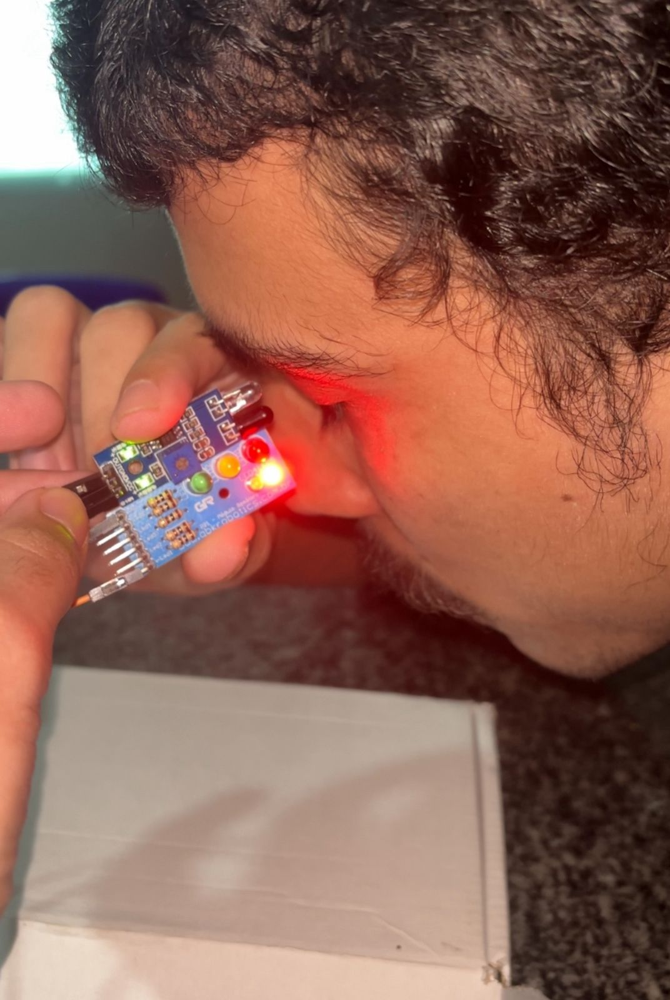

# 🚨 SafeEye – Sistema de Alerta para Motoristas

O **SafeEye** é um projeto embarcado desenvolvido com **ESP32** e um **sensor infravermelho (IR)** acoplado em óculos, com o objetivo de monitorar sinais de sonolência em motoristas de caminhão durante longas viagens.  
Quando detecta que os olhos permanecem fechados por alguns segundos, o sistema dispara um alerta sonoro e visual, além de enviar informações em tempo real para uma base remota via **MQTT**.

---

## 📌 Funcionalidades atuais
- 📡 Conexão Wi-Fi e envio de telemetria em JSON para broker MQTT.  
- 👁️ Detecção de olhos fechados com sensor infravermelho.  
- 🚨 Alerta sonoro (buzzer) e visual (LED) em caso de sonolência.  
- 🔄 Sistema de monitoramento contínuo com ciclos de alerta.  

---

## 🛠️ Tecnologias e componentes
- **ESP32** (microcontrolador principal).  
- **Sensor Infravermelho** (detecção de olhos abertos/fechados).  
- **Buzzer** (alerta sonoro).  
- **LEDs** (status do sistema, Wi-Fi e MQTT).  
- **Broker MQTT** (monitoramento remoto).  

---

## 🚧 Status do projeto
Este projeto **ainda está em desenvolvimento** e receberá melhorias futuras, incluindo:
- 🔧 Otimização da lógica de detecção.  
- 📍 Integração com GPS para monitoramento da localização do motorista.  
- 🌐 Dashboard de monitoramento em tempo real.  
- 🔋 Ajustes de consumo de energia e design final.  

---

## 📷 Imagem do Projeto em Teste

---

## 📌 Observação
O **SafeEye** tem como objetivo **aumentar a segurança nas estradas**, prevenindo acidentes causados por fadiga.  
Este repositório documenta as fases de prototipação, sendo atualizado conforme novas funcionalidades são implementadas.

---
